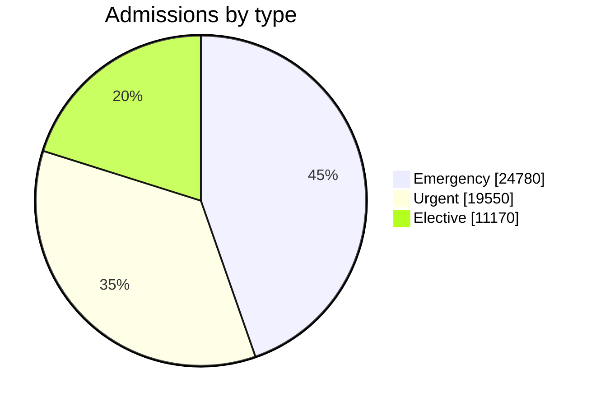

# Healthcare Operations and Billing Dashboard

Which admission type accounts for the largest share of visits? Does it also have the highest average bill? This Power BI report explores patient volume, clinical operations, and billing across three interactive pages.

[Download the Power BI report](./Healthcare%20Operations%20and%20Billing%20Dashboard.pbix) · [Explore the CSV](./healthcare_realistic.csv)

## Admissions at a glance

The accompanying CSV contains **55,500 admission records** from **January 2019 through December 2023**. Emergency admissions make up the largest group, while urgent admissions have the highest average bill.

| Admission type | Share of records | Average billing amount |
| --- | ---: | ---: |
| Emergency | 44.6% | 26,353.07 |
| Urgent | 35.2% | 26,477.81 |
| Elective | 20.1% | 26,220.27 |

Each CSV row counts as one admission in this comparison. Averages use the recorded billing amounts. The CSV does not specify a currency.

## Explore the report

| Report page | Question to explore | Where to look |
| --- | --- | --- |
| **Performance Overview** | How does the admission mix change by year? | Select an admission year, then compare admission types, medical conditions, and test results. |
| **Clinical Operations Overview** | Which conditions and doctors account for the most abnormal results? | Explore the condition-and-doctor matrix alongside patient counts. Use the annual trend for volume context. |
| **Billing and Financial Overview** | How does average billing vary by condition and insurer? | Compare conditions in the column chart, then explore insurance providers in the decomposition tree. |

## Open it locally

1. Download the linked `.pbix` file and open it in **Power BI Desktop**.
2. Start on **Performance Overview** and select a year in the admission-year filter.
3. Open **Clinical Operations Overview** to explore patient volume, or **Billing and Financial Overview** to compare billing amounts.
